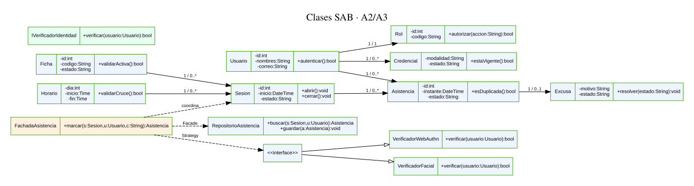

# A2–A3 · Clases y patrones GoF

Editable: [fuente DOT](./02_clases.dot). Exportación [SVG](./02_clases.svg).

## Responsabilidad de clases

El diagrama incluye entidades de dominio y servicios de aplicación. Las clases de negocio tienen atributos tipados, operaciones con parámetros y visibilidad. Los valores de identidad son referencias autorizadas; no representan almacenamiento de biometría cruda.

| Patrón | Problema del SAB | Aplicación y clases | Beneficio |
|---|---|---|---|
| Strategy | La verificación puede usar WebAuthn, facial autorizado o contingencia. | `IVerificadorIdentidad`; `VerificadorWebAuthn`, `VerificadorFacial`; `ServicioAsistencia` recibe la estrategia. | Agregar modalidad sin reescribir el flujo principal. |
| Facade | Marcar asistencia requiere validar sesión/código, identidad y duplicados. | `FachadaAsistencia` coordina `ServicioSesion`, `IVerificadorIdentidad` y `RepositorioAsistencia`. | La interfaz llama una operación clara y el flujo queda centralizado. |

No se usa Singleton: no es necesario imponer un objeto global para este caso.
