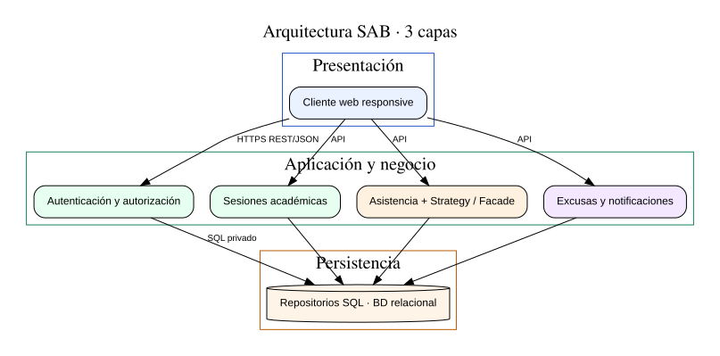

# A4 · Arquitectura propuesta

Editable: [fuente DOT](./03_arquitectura.dot). Comunicación propuesta: HTTPS REST/JSON entre navegador y API; acceso SQL parametrizado solo desde la capa de aplicación.

| Requisito no funcional | Decisión | Alternativa descartada / motivo |
|---|---|---|
| RNF-SAB-001 control por rol | Middleware en API y validación de alcance por ficha/sede | Validar solo en interfaz permite saltarse permisos. |
| RNF-SAB-002 TLS | TLS termina en proxy/API; tráfico interno restringido | HTTP público expone datos de sesión. |
| RNF-SAB-007 p95 ≤3 s | API modular, consultas parametrizadas e índices; medir antes de ampliar capacidad | Microservicios elevan operación para el tamaño académico. |
| RNF-SAB-012 adaptable | Cliente web responsive y pruebas 320/768/1280 px | App nativa no es necesaria para el alcance inicial. |
