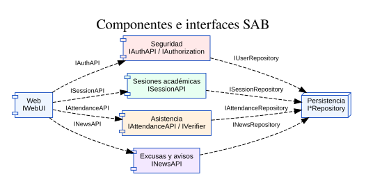

# A5 · Componentes e interfaces

Editable: [fuente DOT](./04_componentes.dot).

| Componente | Provee | Requiere | Requisitos |
|---|---|---|---|
| Interfaz web | `IWebUI` | `IAuthAPI`, `IAttendanceAPI`, `IReportAPI` | RF-001, 018, 029, 045; RNF-012 |
| Seguridad y acceso | `IAuthAPI`, `IAuthorization` | `IUserRepository` | RF-001–005; RNF-001, 003 |
| Sesiones académicas | `ISessionAPI` | `ISessionRepository`, `IAuthorization` | RF-018–023, 055, 071 |
| Asistencia | `IAttendanceAPI`, `IVerifierIdentity` | `ISessionAPI`, `IAttendanceRepository` | RF-024–039, 057–064, 079–080 |
| Excusas y avisos | `INewsAPI` | `IUserRepository`, `INewsRepository` | RF-040–043, 073–077, 084, 089–094 |
| Persistencia | `I*Repository` | Motor relacional | RNF-006, 020, 025 |
