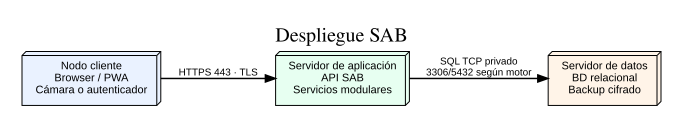

# A6 · Vista de despliegue

Editable: [fuente DOT](./05_despliegue.dot).

| Nodo | Artefactos | Protocolo / puerto | RNF atendido |
|---|---|---|---|
| Navegador móvil/PC | Cliente web SAB, cámara/WebAuthn del dispositivo | HTTPS 443 | RNF-002 TLS y RNF-012 responsive |
| Servidor aplicación | API SAB y servicios | HTTPS 443 desde borde; SQL privado hacia BD | RNF-001 autorización, RNF-007 rendimiento |
| Servidor de datos | Base relacional, respaldos | TCP 3306/5432 privado según motor elegido | RNF-006 auditoría; RNF-010 respaldo |

Los puertos del motor son alternativas, no configuración final. La base no se publica a Internet.
