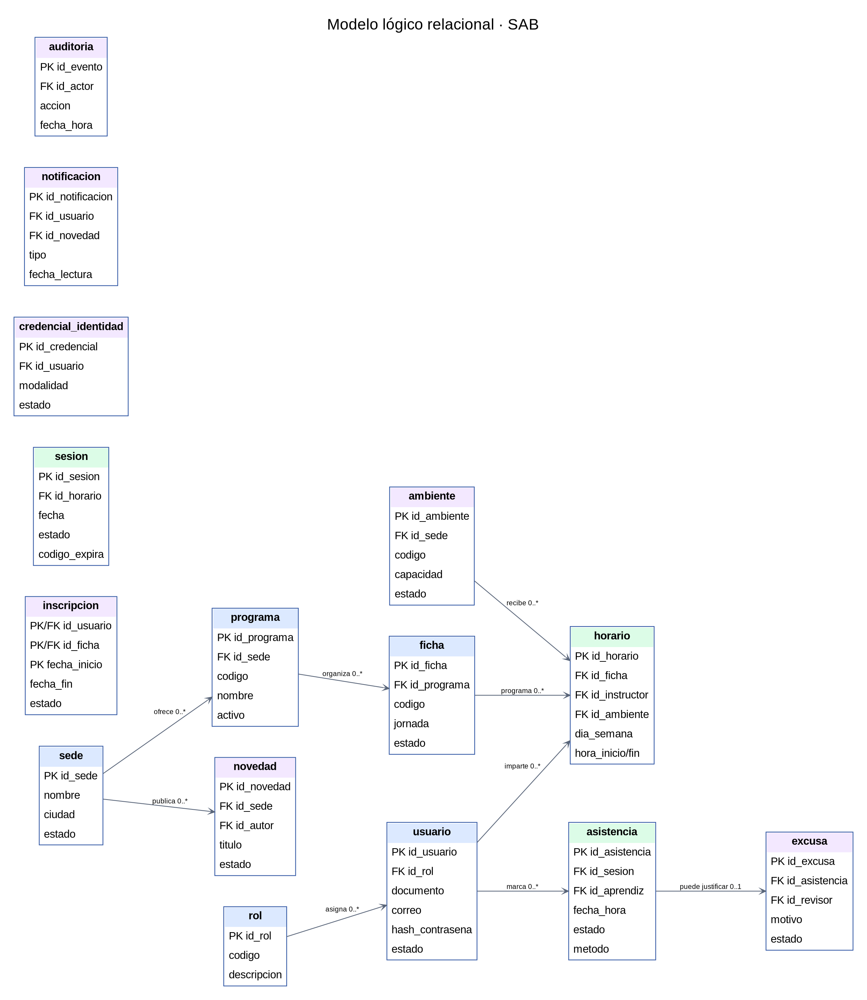

# B2 · Modelo lógico relacional y transformación

**Motor propuesto para la evidencia académica:** SQLite 3, relacional. El SRS no fija un motor. Se elige para validar localmente las claves, restricciones y consultas del prototipo; la elección de producción queda pendiente de decisión del equipo.

Fuente editable: [02_modelo_logico.drawio](./02_modelo_logico.drawio). Exportación: [SVG](./02_modelo_logico.svg). Script exacto: [05_esquema_sab.sql](./05_esquema_sab.sql).

## Reglas de transformación aplicadas

| Regla | Aplicación al modelo SAB | Resultado |
|---|---|---|
| Entidad fuerte | Cada entidad se transforma en tabla con PK propia. | `sede`, `programa`, `ficha`, `rol`, `usuario`, `ambiente`, `horario`, `sesion`, `credencial_identidad`, `asistencia`, `excusa`, `novedad`, `notificacion`, `auditoria`. |
| 1:N | La FK se ubica en el lado N. | `programa.id_sede`, `ficha.id_programa`, `horario.id_ficha`, `sesion.id_horario`, entre otras. |
| N:M | Se crea tabla intermedia con las dos FK y atributos de la relación. | `inscripcion` con PK compuesta, vigencia y estado. |
| 1:0..1 | FK en la tabla dependiente y restricción UNIQUE. | `excusa.id_asistencia UNIQUE` permite como máximo una excusa por marca. |
| Atributos multivaluados | Se separa el dato repetible en una entidad relacionada si el dominio lo requiere. | Las credenciales se guardan en `credencial_identidad` (cero o varias por usuario); no se guarda dato biométrico crudo. |
| Datos de rol | Se separa el catálogo de rol de la cuenta. | `usuario.id_rol` evita repetir descripción/código del rol. No hay subtipos de usuario en el alcance: la autorización se controla mediante rol y reglas de aplicación. |
| Auditoría histórica | Se conserva actor nullable para eventos de sistema o cuentas retiradas. | `auditoria.id_actor` usa `ON DELETE SET NULL`; el detalle no debe contener secretos. |

Las columnas `total` de paneles se calculan a partir de registros; no se almacenan copias derivadas. La validación de cruces de horario requiere transacción y regla de aplicación, además de los tipos y checks incluidos.
