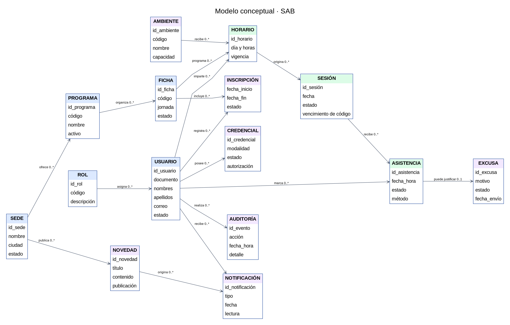

# B1 · Modelo conceptual SAB

**Notación:** entidad con atributos representativos; `id_*` identifica cada entidad. Cardinalidad escrita como mínimo..máximo en cada extremo. Las tablas no se presentan como decisión física salvo en el producto lógico.

Fuente editable: [03_modelo_conceptual.drawio](./03_modelo_conceptual.drawio). Exportación: [SVG](./03_modelo_conceptual.svg).

| Entidad | Identificador y atributos de negocio | RF de referencia |
|---|---|---|
| Sede | id_sede, nombre, ciudad, estado | RF-SAB-006, 010, 011 |
| Programa | id_programa, código, nombre, activo | RF-SAB-065, 068 |
| Ficha | id_ficha, código, jornada, estado | RF-SAB-007, 067, 086 |
| Rol | id_rol, código, descripción | RF-SAB-003, 095 |
| Usuario | id_usuario, documento, nombres, apellidos, correo, estado | RF-SAB-001 a 016, 069, 085, 095 a 097 |
| Inscripción | usuario, ficha, vigencia, estado | RF-SAB-012 a 016, 060 |
| Ambiente | id_ambiente, código, nombre, capacidad | RF-SAB-066, 086 a 088 |
| Horario | ficha, instructor, ambiente, día, horas, vigencia | RF-SAB-067, 086 a 088 |
| Sesión | horario, fecha, estado, código temporal y vencimiento | RF-SAB-018 a 023, 025 a 027, 055, 071, 078, 080 |
| Credencial de identidad | usuario, modalidad, estado, autorización | RF-SAB-017, 024, 028, 051, 057, 058, 061, 064, 070, 077 |
| Asistencia | sesión, aprendiz, instante, estado, método, origen | RF-SAB-029 a 030, 036 a 039, 044 a 046, 059, 063, 079, 082 |
| Excusa | asistencia, motivo, soporte, estado, revisión | RF-SAB-040 a 043, 073 a 074, 081 |
| Novedad | sede, autor, texto, fecha, estado | RF-SAB-089 a 092, 094 |
| Notificación | usuario, novedad, tipo, mensaje, lectura | RF-SAB-032, 074, 084, 090 |
| Auditoría | actor, acción, entidad, fecha y detalle | RF-SAB-009, 033, 050, 054, 085, 092 |

## Relaciones y cardinalidades

| Relación | Cardinalidad min..máx | Lectura |
|---|---|---|
| Sede — Programa | Sede 1..1; Programa 1..* | Cada programa pertenece a una sede; una sede ofrece programas. |
| Programa — Ficha | Programa 1..1; Ficha 1..* | Cada ficha pertenece a un programa; un programa agrupa fichas. |
| Rol — Usuario | Rol 1..1; Usuario 0..* | Cada cuenta tiene un rol; un rol se asigna a varias cuentas. |
| Usuario — Ficha mediante Inscripción | Usuario 0..*; Ficha 0..* | Relación N:M con fechas y estado propios. |
| Ficha — Horario | Ficha 1..1; Horario 0..* | El horario programa una ficha. |
| Usuario instructor — Horario | Instructor 1..1; Horario 0..* | Cada horario identifica al instructor responsable. |
| Ambiente — Horario | Ambiente 1..1; Horario 0..* | El horario reserva un ambiente. |
| Horario — Sesión | Horario 1..1; Sesión 0..* | Un horario origina sesiones en fechas distintas. |
| Usuario — Credencial | Usuario 1..1; Credencial 0..* | Una persona puede autorizar o revocar credenciales. |
| Sesión — Asistencia | Sesión 1..1; Asistencia 0..* | La asistencia pertenece a una sesión. |
| Usuario aprendiz — Asistencia | Aprendiz 1..1; Asistencia 0..* | Cada marca corresponde a un aprendiz. |
| Asistencia — Excusa | Asistencia 1..1; Excusa 0..1 | La excusa justifica como máximo una asistencia/ausencia. |
| Sede — Novedad | Sede 1..1; Novedad 0..* | La publicación pertenece a una sede. |
| Novedad — Notificación | Novedad 0..1; Notificación 0..* | Una publicación puede generar avisos. |
| Usuario — Notificación | Usuario 1..1; Notificación 0..* | Cada aviso tiene un destinatario. |
| Usuario — Auditoría | Usuario 0..1; Evento 0..* | Un evento puede conservar actor o quedar como evento del sistema. |

La relación N:M Usuario–Ficha se resuelve con Inscripción, que guarda vigencia y estado. Horario vincula ficha, instructor y ambiente y evita una asociación ternaria implícita. La identidad biométrica se modela como credencial/referencia autorizada; no se propone guardar huellas crudas ni plantillas faciales aquí.
